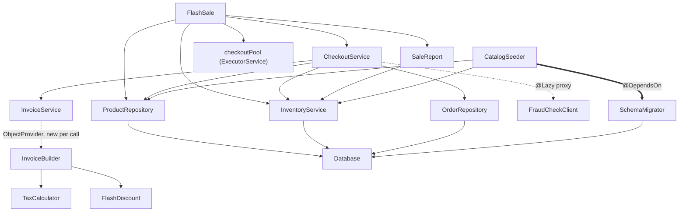

# Checkout Engine — Spring Core Project 6

## Summary

A console checkout engine for a Black Friday flash sale, built on the plain Spring core container (no Spring Boot). Three VIP orders run one after another, then 90 customers check out at the same time, each on its own virtual thread, competing for the 60 units left in stock. A final report checks three guarantees: no overselling, unique order IDs, and every invoice holds only its own lines.

**Stack:** Java 25, Spring Framework 7.0.10 (`spring-context`), Jakarta Annotations 3.0.0, Maven.

---

## What It Demonstrates

| Concept | Where in the Code |
|---|---|
| Prototype scope | `InvoiceBuilder`: `@Scope("prototype")`. It keeps per-invoice state (`orderId`, `customer`, `lines`), so every invoice needs a new instance. The `builder #N` in each invoice header shows which instance built it |
| Prototype inside a singleton (`ObjectProvider`) | `InvoiceService` (singleton) holds an `ObjectProvider<InvoiceBuilder>` and calls `builders.getObject()` in `issue()`, which returns a new builder for every invoice |
| Thread-safe order IDs (`AtomicInteger`) | `OrderRepository.nextId()`: `nextNumber.getAndIncrement()` reads and increments in one atomic step. IDs start at `ORD-1001` |
| Thread-safe stock (`ConcurrentHashMap.compute`) | `InventoryService.reserve()`: read, check and write run inside one `stock.compute(sku, ...)` call, which is atomic per SKU. When stock runs out it throws `IllegalStateException("<sku> is sold out")` |
| Concurrent checkout | `FlashSale.runFlashSale()`: one `Callable` per customer, all submitted with `checkoutPool.invokeAll(tasks)`. `tryCheckout()` turns a sold-out exception into `Optional.empty()` |
| `@DependsOn` | `CatalogSeeder`: `@DependsOn("schemaMigrator")`. `SchemaMigrator.migrate()` creates the tables in `@PostConstruct`, and `CatalogSeeder.seed()` writes to them. Neither bean injects the other, so only `@DependsOn` guarantees the order |
| `@Lazy` on the class | `FraudCheckClient`: `@Lazy`, so the slow client (`fraud.startup-ms`) is not created at startup |
| `@Lazy` on the injection point | `CheckoutService` constructor: `@Lazy FraudCheckClient fraudCheck` injects a proxy. The real bean is created on the first `approve()` call, i.e. the first invoice above `fraud.threshold` (VIP order 3, the PS5 at 22,800 EGP), which is why `[fraud] connecting ...` prints between VIP invoices 2 and 3 |
| `ExecutorService` as a `@Bean` | `InfraConfig.checkoutPool()` returns `Executors.newVirtualThreadPerTaskExecutor()`. No code shuts it down: when the try-with-resources in `EngineApp` closes the context, Spring shuts the executor down (inferred destroy method) and waits for running tasks |
| Strict placeholders | `AppConfig`: `static` `@Bean` `PropertySourcesPlaceholderConfigurer`. No `@Value` has a `:default`, so a missing key stops startup with `Could not resolve placeholder 'shop.tax-rate' in value "${shop.tax-rate}"`. Without this bean Spring's fallback resolver is lenient, and a missing `fraud.host` would be injected as the literal text `${fraud.host}`. The method is `static` so Spring can register this `BeanFactoryPostProcessor` without creating `AppConfig` first |
| `@PropertySource` + `@Value` | `AppConfig` loads `app.properties`. `@Value("${...}")` constructor parameters in `Database`, `FlashDiscount`, `TaxCalculator`, `FraudCheckClient`, `CheckoutService`, `FlashSale` |
| `@PostConstruct` | `SchemaMigrator.migrate()` creates the tables, `CatalogSeeder.seed()` loads 3 products and their stock |
| Immutable data | `Invoice`, `Invoice.Line`, `Order`, `Product` are records. The compact constructor in `Invoice` copies `lines` with `List.copyOf` |

---

## Package Structure

```
src/main/java/com/shop/engine/
│
├── config/
│   └── InfraConfig.java              ← @Configuration + @Bean — checkoutPool (virtual-thread ExecutorService)
│
├── storage/
│   ├── Database.java                 ← @Component — table registry + simulated latency in roundTrip()
│   └── SchemaMigrator.java           ← @Component + @PostConstruct — creates products, stock, orders tables
│
├── catalog/
│   ├── Product.java                  ← record — sku, name, price
│   ├── ProductRepository.java        ← @Repository — in-memory products (needs the products table)
│   └── CatalogSeeder.java            ← @Component + @DependsOn("schemaMigrator") + @PostConstruct — seeds 3 products, 63 units
│
├── inventory/
│   └── InventoryService.java         ← @Service — stock per SKU, atomic reserve() with compute
│
├── pricing/
│   ├── FlashDiscount.java            ← @Component + @Value — flash.discount-percent
│   └── TaxCalculator.java            ← @Component + @Value — shop.tax-rate
│
├── invoice/
│   ├── Invoice.java                  ← record + nested Line record — immutable invoice
│   ├── InvoiceBuilder.java           ← @Component + @Scope("prototype") — collects lines, builds one invoice
│   └── InvoiceService.java           ← @Service — ObjectProvider<InvoiceBuilder>, new builder per invoice
│
├── fraud/
│   └── FraudCheckClient.java         ← @Component + @Lazy — slow simulated start, approves every invoice
│
├── order/
│   ├── Order.java                    ← record — id, customer, sku, quantity, invoice
│   ├── OrderRepository.java          ← @Repository — orders map + AtomicInteger IDs (ORD-1001, ...)
│   └── CheckoutService.java          ← @Service + @Lazy injection — find → reserve → ID → invoice → fraud → save
│
├── sale/
│   ├── FlashSale.java                ← @Component — VIP early access + concurrent flash sale
│   └── SaleReport.java               ← @Component — sales per SKU, revenue, 3 guarantee checks
│
├── AppConfig.java                    ← @Configuration + @ComponentScan + @PropertySource + static placeholder configurer
└── EngineApp.java                    ← Main — opens the context with try-with-resources, runs FlashSale

src/main/resources/
└── app.properties                    ← tax, discount, customers, DB latency, fraud settings
```

---

## Bean Dependencies

`EngineApp` gets `FlashSale` from the context. Solid arrows are constructor injection, dotted arrows are resolved on use, and the thick arrow is ordering only (no reference).



---

## Configuration

`src/main/resources/app.properties`

| Key | Value | Used by | Meaning |
|---|---|---|---|
| `shop.tax-rate` | `14` | `TaxCalculator` | Tax in percent, applied after the discount |
| `flash.discount-percent` | `20` | `FlashDiscount` | Flash-sale discount in percent of the subtotal |
| `flash.customers` | `90` | `FlashSale` | Number of customers in the concurrent flash sale |
| `flash.threads` | `16` | *(not used)* | No class reads it. The executor is `newVirtualThreadPerTaskExecutor()`, one virtual thread per customer |
| `db.latency-ms` | `2` | `Database` | Simulated delay in `roundTrip()`. It widens the race windows so the bugs below show up |
| `fraud.threshold` | `20000` | `CheckoutService` | Invoices with a total above this (EGP) go through `FraudCheckClient.approve()` |
| `fraud.host` | `fraud.example.com` | `FraudCheckClient` | Host printed in `[fraud] connecting to ...` (simulated, no network call) |
| `fraud.startup-ms` | `1500` | `FraudCheckClient` | Simulated slow start in the constructor |

Any key can be overridden without editing the file. Lookup order: JVM system property (`-D`) first, then environment variable, then `app.properties`. For environment variables, Spring maps `flash.customers` to `FLASH_CUSTOMERS`.

Seeded catalog (`CatalogSeeder`):

| SKU | Product | Price (EGP) | Stock | Invoice total for 1 unit |
|---|---|---|---|---|
| `PS5-001` | PlayStation 5 | 25,000 | 11 | 22,800 (above `fraud.threshold`) |
| `APD-001` | AirPods Pro | 10,000 | 21 | 9,120 |
| `KND-001` | Kindle | 6,000 | 31 | 5,472 |

Each VIP order takes one unit, which leaves 60 units for the flash sale. Customers are spread round-robin over the 3 SKUs.

---

## How to Run

Requires JDK 25.

### IntelliJ IDEA

1. Open `project-06-Checkout-Engine` as a Maven project
2. Run `com.shop.engine.EngineApp`

To change the number of customers, open **Run → Edit Configurations…**, select `EngineApp`, and use one of:

| Option | Value |
|---|---|
| **VM options** (enable via **Modify options → Add VM options**) | `-Dflash.customers=30000` |
| **Environment variables** | `FLASH_CUSTOMERS=30000` |

With 30,000 customers there are still only 60 units, so the report shows `customers: 30000 | placed: 60 | sold out: 29940` and all three checks stay `[OK]`.

---

## Sample Output

<details>
<summary>Default run (90 customers)</summary>

```text
Checkout Engine starting...
[db] migrated: products, stock, orders
[seed] 3 products, 63 units in stock
=== VIP early access ===
--- Invoice ORD-1001 for vip-1 (builder #1) ---
KND-001  Kindle        1 x 6,000
subtotal 6,000 - discount 1,200 + tax 672 = 5,472 EGP
--- Invoice ORD-1002 for vip-2 (builder #2) ---
APD-001  AirPods Pro   1 x 10,000
subtotal 10,000 - discount 2,000 + tax 1,120 = 9,120 EGP
[fraud] connecting to fraud.example.com ...
[fraud] ready
--- Invoice ORD-1003 for vip-3 (builder #3) ---
PS5-001  PlayStation 5 1 x 25,000
subtotal 25,000 - discount 5,000 + tax 2,800 = 22,800 EGP
=== Flash sale: 90 customers ===
=== Flash sale report ===
customers: 90 | placed: 60 | sold out: 30
PS5-001  sold 10 of 10, left 0
APD-001  sold 20 of 20, left 0
KND-001  sold 30 of 30, left 0
revenue: 574,560 EGP
[OK] no overselling
[OK] order IDs are unique (60 of 60)
[OK] every invoice has its own lines
Checkout Engine stopped
```

</details>

---

## Bugs on Purpose

Five mistakes this project was built to show. Each row breaks one guarantee; the current code has the fix.

| # | Mistake | What you see | Fix in the current code |
|---|---|---|---|
| 1 | No `@DependsOn` on `CatalogSeeder` | Startup fails: `Error creating bean with name 'catalogSeeder'` … `Caused by: java.lang.IllegalStateException: table products does not exist` | `@DependsOn("schemaMigrator")`, so the tables exist before `seed()` runs |
| 2 | `InvoiceBuilder` injected directly into `InvoiceService` | The singleton keeps one builder: every invoice says `builder #1` and collects the lines of all earlier invoices. The flash sale ends with `[FAIL] 60 invoices have lines from other orders` or crashes with `ConcurrentModificationException` | `ObjectProvider<InvoiceBuilder>` + `getObject()` for every invoice |
| 3 | `@Lazy` on the `FraudCheckClient` class only | `CheckoutService` is an eager singleton that needs the real bean, so `[fraud] connecting ...` and the 1.5 s wait happen at startup, before `=== VIP early access ===` | `@Lazy` on the constructor parameter too, so a proxy is injected |
| 4 | Order ID as read → `roundTrip()` → write (`get()`, then `set(current + 1)`) | Customers read the same number: `[FAIL] duplicate order IDs: 49 unique of 60` (the count varies) | `nextNumber.getAndIncrement()`, one atomic step |
| 5 | Check-then-act stock reservation (`getOrDefault` → check → `roundTrip()` → `put`) | Everyone sees the same stock: `placed: 90 \| sold out: 0`, `[FAIL] overselling: PS5-001 sold 30 of 10`, `[FAIL] overselling: APD-001 sold 30 of 20` | Read, check and write inside one `stock.compute(sku, ...)` |

---

## Next

**Spring Boot + REST.** Spring Boot auto-configuration replaces the manual setup here (`AnnotationConfigApplicationContext`, `@PropertySource`, the placeholder configurer), and checkout is exposed through REST endpoints instead of a console run.
